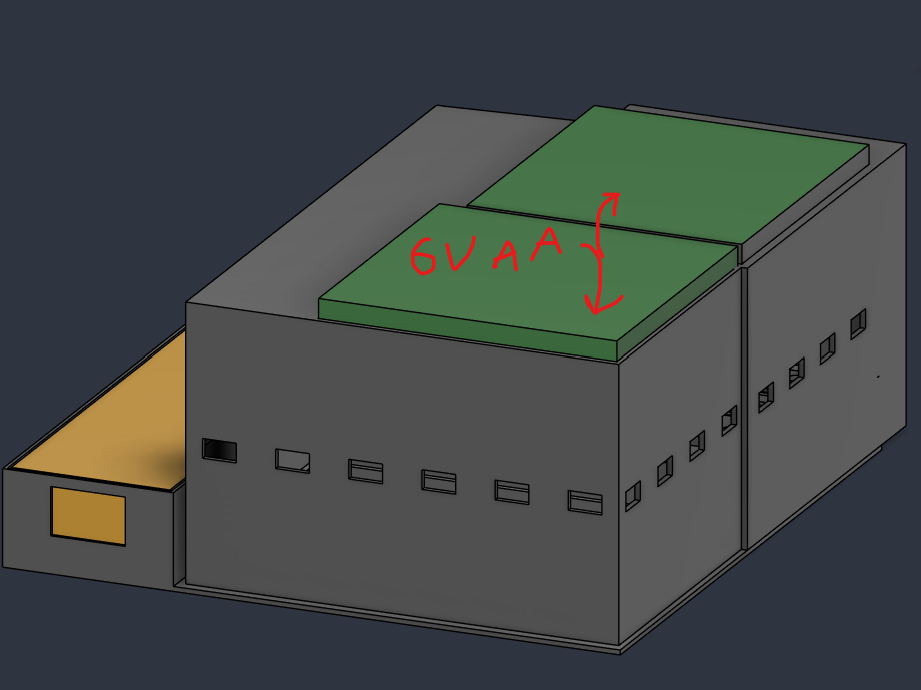

# Zapatron

**A wearable, head-tilt-triggered wake-up system built from two ESP32 boards, an IMU, servos and 3D-printed parts.**

Zapatron was built to tackle a simple problem: students falling asleep in class. A head-mounted ESP32 watches how far your head has dropped and, if it stays down too long, wirelessly tells a second ESP32 to physically operate an external EMS/TENS unit.

~8 months of design, 3D modelling, firmware and testing. Everything needed to recreate it is in this repo.



## Demo

<!-- TODO: add the new demo video and build photos here, e.g.
[Watch the demo](showcase/demo.mp4)

-->

## Designed and built by me

The system architecture, firmware and enclosures are my own work (third-party parts are credited below):

- **Custom 3D-modelled enclosures** for both boards, with cases and caps sized to fit the breadboards and battery packs.
- **A custom fit for the EMS/TENS unit**, so the slave board mounts directly to it.
- **A servo box with rack-and-pinion linear actuators integrated into it** (75 mm pusher), which let the servos operate the EMS unit's controls externally. The actuator mechanism is adapted from a third-party design, credited below.
- Firmware for both ESP32s, the Bluetooth protocol between them, and the wiring.

All printable files are in [`Models/`](Models).

## How it works

Two ESP32 DevKitC boards talk over Bluetooth Classic:

| Board | Role | Hardware |
|-------|------|----------|
| **Master** (worn on the head) | Reads head pitch and sends its state | ESP32, MPU6050 gyroscope/accelerometer, AAA battery pack |
| **Slave** (on the EMS unit) | Receives state and moves the actuators | ESP32, 2x MG90S servos, 3D-printed linear actuators, AA battery pack |

1. The **master** reads the MPU6050 over I2C about every 50 ms and computes head **pitch** from the accelerometer.
2. If pitch stays below a threshold (head dropped) for a set hold time, it sends a JSON message over Bluetooth, e.g. `{"below":true,"above":false,"boot":false,"pitch":-57.3}`.
3. The **slave** parses the JSON and drives its servos, which operate the EMS unit's controls through the linear actuators, while the head stays down.
4. When the head comes back up, the master sends a `boot` message that triggers a reset sequence on the second servo.
5. If the Bluetooth link drops, the slave returns to its rest position and signals on reconnect, and the onboard LED shows connection state on both boards.

### Tuning

In `MasterESP32/main.cpp`:

- `pitchThreshold`: how far the head must tilt down (degrees).
- `holdTime`: how long it must stay down before triggering (milliseconds).

The values currently in the file are the short *testing* settings. Adjust them for real use.

## Repository layout

```
MasterESP32/   Firmware for the head-mounted gyroscope board
SlaveESP32/    Firmware for the servo/actuator board
Models/        3D-printable cases, caps and actuator parts (.stl) plus renders
showcase/      Demo video and screen recording
Bill of Materials and Full Assembly Instructions.md
```

## Build it

1. Parts and assembly: see the [Bill of Materials and Full Assembly Instructions](Bill%20of%20Materials%20and%20Full%20Assembly%20Instructions.md).
2. 3D print the parts in [`Models/`](Models).
3. Install [VS Code](https://code.visualstudio.com/) with the PlatformIO extension.
4. Create one PlatformIO project per board (board: **ESP32 DevKitC**, framework: **Arduino**). Set `monitor_speed = 115200`.
5. Flash `MasterESP32/main.cpp` and `SlaveESP32/main.cpp` to the matching boards.
6. Libraries: MPU6050 (master), ArduinoJson (both), ESP32Servo (slave), BluetoothSerial (built into the ESP32 Arduino core).
7. Power both boards. When they pair, the blue LED turns on for each.

**Tip:** use lithium AAA batteries for the gyroscope board to avoid voltage drop and brownouts.

## Safety and disclaimer

This is a personal hobby prototype, **not a medical or commercial product**.

- It is designed around one specific EMS/TENS unit (listed in the BOM) and **will not work with every unit**.
- Follow the manufacturer's safety instructions and terms of service for any EMS/TENS device.
- I am not responsible for harm caused by this project or by incorrect use of the EMS device. Build and use at your own risk.

## Credits

- Linear actuator mechanism based on [Linear Servo Actuators](https://www.thingiverse.com/thing:3170748) by **potentprintables** on Thingiverse, licensed under [CC BY-NC](https://creativecommons.org/licenses/by-nc/4.0/). The actuator parts in `Models/SlaveModels/Linear Actuators/` are derived from or adapted from that design. Non-commercial use only.

## Tech

C++ (Arduino framework) · PlatformIO · ESP32 · Bluetooth Classic · I2C · MPU6050 · ArduinoJson · servo control · 3D printing (STL)
